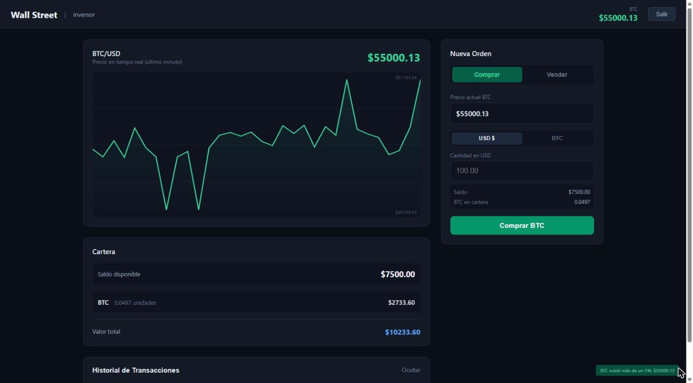
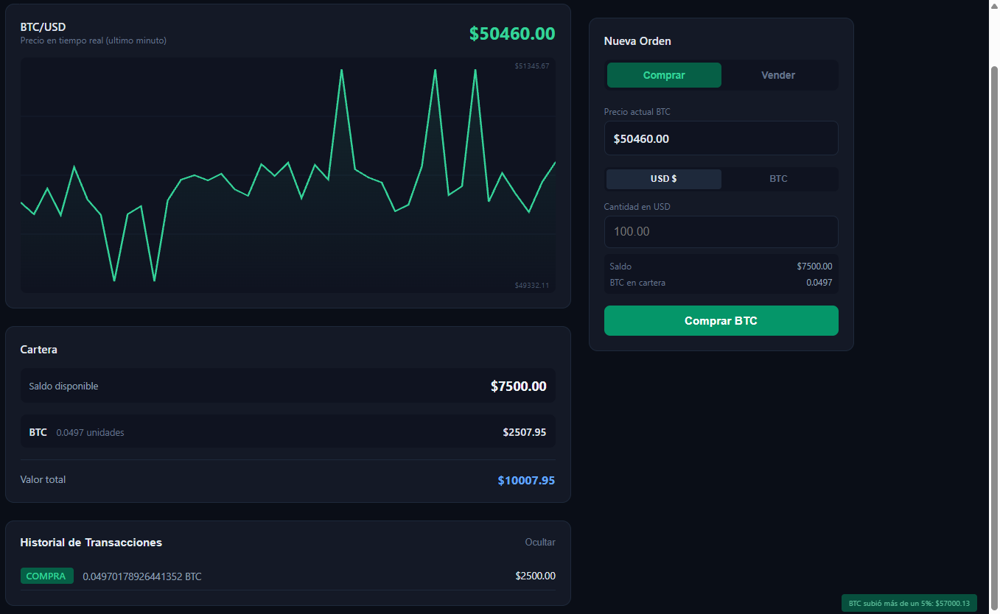
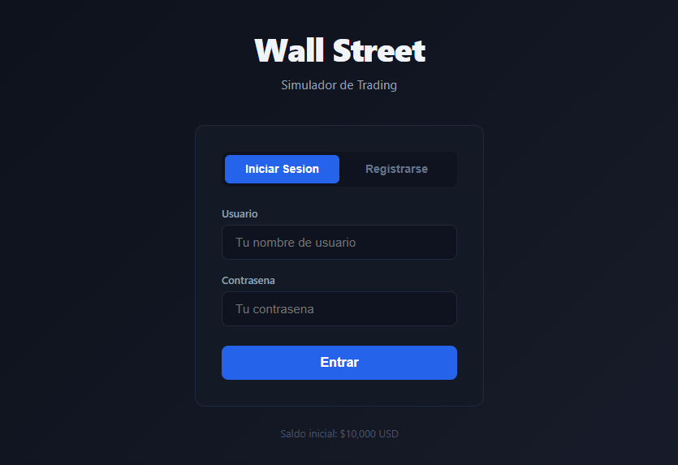
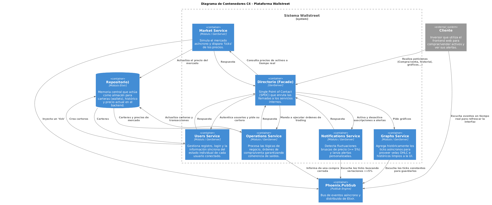

# Wall Street: simulador de trading en Elixir

Plataforma web que simula un mercado bursátil en tiempo real. Los usuarios se registran, reciben un saldo inicial, compran y venden activos y ven cómo evoluciona su cartera mientras el precio cambia cada segundo.

Está construida sobre **Elixir/OTP** y **Phoenix LiveView**: cada servicio es un proceso supervisado, la interfaz se actualiza sin recargar la página y, si un proceso falla, su supervisor lo reinicia automáticamente.

> Proyecto desarrollado por un equipo de 5 personas para la asignatura *Arquitectura del Software* del Grado en Ingeniería Informática (Universidade da Coruña).

## Funcionalidades

- Registro e inicio de sesión de usuarios, con un saldo inicial de 10.000.
- Compra y venta de activos a precio de mercado.
- Cartera en tiempo real: saldo disponible, posiciones abiertas y pérdidas o ganancias.
- Historial de transacciones del usuario.
- Gráfico del precio que se actualiza con cada tick del mercado.
- Alertas cuando el precio de un activo comprado varía más allá de un umbral.

## Capturas

**Dashboard:** precio de BTC en tiempo real, cartera, formulario de órdenes y una alerta de subida de precio (abajo a la derecha).



**Cartera e historial de transacciones tras una compra**



**Inicio de sesión y registro**



## Tecnologías

| | |
|---|---|
| Lenguaje | Elixir (OTP) |
| Web | Phoenix 1.7, Phoenix LiveView |
| Tiempo real | Phoenix.PubSub |
| Persistencia | Mnesia |
| Tests | ExUnit (unitarios, integración, concurrencia y resiliencia) |

## Arquitectura

Un **Directorio** actúa como punto de entrada único y delega en servicios especializados. Cada uno es un `GenServer` dentro del árbol de supervisión de la aplicación:

| Servicio | Responsabilidad |
|---|---|
| `MarketServer` | Carga los precios de `priv/data/precios.csv` y emite un tick por segundo |
| `OperationsServer` | Ejecuta órdenes de compra y venta y registra las transacciones |
| `GraphsServer` | Guarda el histórico de precios y calcula datos para el gráfico |
| `NotificationsServer` | Vigila los precios y avisa a cada usuario cuando salta una alerta |
| `UserSupervisor` / `UserServer` | Un proceso por usuario conectado, creado dinámicamente |
| `Repo` | Abstrae la persistencia de usuarios, carteras y transacciones en Mnesia |

Los servicios se comunican con la interfaz mediante eventos de PubSub (`market:prices`, `user:<id>:alerts`…), de modo que el dashboard de LiveView se actualiza en cuanto cambia un precio o se ejecuta una orden.



En [`docs/`](docs/) hay más documentación: [requisitos](docs/requisitos.md), [decisiones de arquitectura (ADRs)](docs/ADR.md), [diagramas C4](docs/diagramas/), la [estrategia de pruebas](docs/pruebas_documentacion.md) y la [presentación del proyecto](docs/presentacion.pdf).

## Cómo ejecutarlo

Requisitos: Elixir 1.15 o superior y Erlang/OTP.

```bash
mix deps.get
mix compile
iex --sname wallstreet -S mix phx.server
```

La aplicación queda disponible en http://localhost:4000. Desde la página de inicio puedes registrar un usuario nuevo y entrar al dashboard.

En Windows con PowerShell, usa `iex.bat` en lugar de `iex`, porque `iex` es un alias de otro comando de PowerShell.

El parámetro `--sname` le da un nombre al nodo de Erlang. Mnesia lo necesita para guardar los datos en disco; si arrancas solo con `mix phx.server`, los usuarios y las carteras se pierden al cerrar la aplicación.

### Tests

```bash
mix test
```

Además de las pruebas unitarias de cada servicio, hay tests de integración con PubSub y LiveView, tests de concurrencia con varios usuarios operando a la vez y tests que matan procesos para comprobar que el supervisor los reinicia.

## Limitaciones conocidas

- Es un proyecto académico: las contraseñas se guardan sin cifrar y la sesión del navegador conserva las credenciales para no pedir login al recargar. En un sistema real habría que usar un hash (por ejemplo, Bcrypt) y guardar solo un token en la sesión.
- La monitorización de servicios mediante *heartbeats* quedó planteada pero sin implementar (ver ADR-007).
- Solo se simula un activo, con precios precargados desde un fichero.
