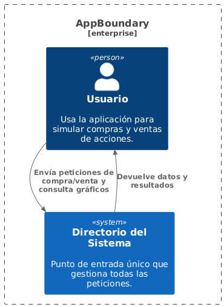
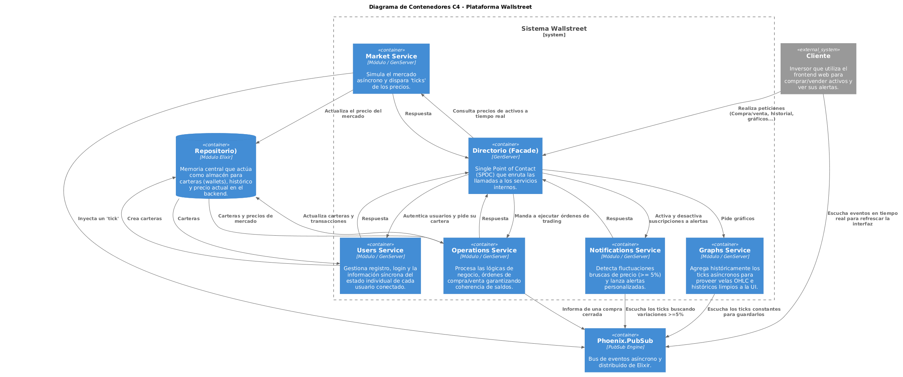

# 💡 PROPUESTA
## *Wall Street*

## 1. Descripción  
**Wall Street** es una plataforma de trading diseñada para ofrecer una experiencia de inversión fluida, segura y de alto rendimiento en los mercados financieros.

## 2. Funcionalidades principales  
La plataforma se articula en torno a los siguientes servicios clave:
* **Gestión Transaccional**: ejecución de órdenes de compra y venta de activos en bolsa.
* **Análisis de Mercado**: visualización interactiva de gráficos de precios.
* **Gestión de Cartera**: administración de los activos y transacciones del usuario.
* **Sistema de Notificaciones**: Alertas inteligentes sobre fluctuaciones y movimientos críticos de precios.

## 3. Atributos de calidad y rendimiento
Para cumplir con los estándares del sector financiero, el sistema prioriza:
* **Baja latencia**: Optimización extrema en la visualización de precios y ejecución de órdenes para garantizar competitividad.
* **Tolerancia a fallos**: Implementación de mecanismos de recuperación y consistencia para asegurar la integridad de cada transacción financiera.

## 4. Arquitectura del Sistema
El diseño de nuestro sistema se fundamenta en una arquitectura **Cliente-Servidor**.

### 4.1 Desacoplamiento y servicios
El sistema utiliza un **Directorio** como punto de entrada único, ocultando la topología interna. Los servicios están especializados por dominio:
* Mercado
* Operaciones
* Usuarios
* Gráficos
* Notificaciones

### 4.2 Persistencia y tiempo real
* **Arquitectura en repositorio**: se utiliza para la comunicación interna entre los servicios. Se emplea tambiénpara centralizar la lógica de persistencia de datos (usuarios, carteras y transacciones), abstrayendo la implementación de la base de datos.
* **Comunicación basada en eventos**: La actualización instantánea del frontend se logra mediante **Phoenix.PubSub**. El sistema utiliza el modelo de suscripción a *topics* para emitir actualizaciones asíncronas en tiempo real.
* **Interfaz de usuario**: La aplicación web actúa como el cliente principal del ecosistema. 

---

### Visualización Arquitectónica

> Consulte el directorio `doc/diagramas/` para una revisión exhaustiva de los diagramas C4.

